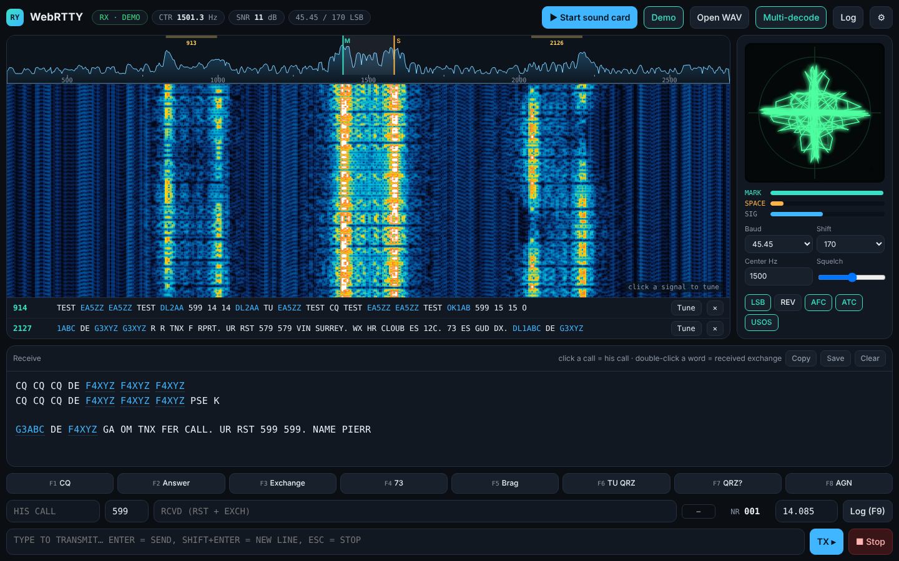

# WebRTTY

**A modern RTTY modem for HF amateur radio that runs in your browser — no install, any OS.**

WebRTTY decodes and transmits 45.45-baud Baudot RTTY (and other common speeds/shifts) through your computer's sound card. It is a single self-contained HTML file: open it in Chrome or Edge, connect your rig's audio, and start copying.

**▶ Live app:** https://loorisr.github.io/webrtty/



---

## Features

**Receive**
- Waterfall + spectrum display with **click-to-tune** that snaps to the nearest mark/space pair
- **Multi-decode:** finds every RTTY signal on the waterfall and decodes them all at once (up to 8 channels). Click **Tune** on a channel to make it the main QSO.
- Classic **crossed-ellipse tuning scope** and mark/space level bars
- Matched-filter FSK demodulator with an **adaptive ATC** (automatic threshold correction). It detects whether the path is showing selective/multipath fading or fast polar **flutter**, and switches strategy on the fly.
- **AFC** with **automatic acquisition**: if you are up to ±100 Hz off, it searches for the mark/space pair and locks on. A lone carrier cannot fool it, because mark and space must take turns.
- **Notch filter:** Shift+click or right-click on the waterfall to notch a carrier. If the notch lands on one of the two tones, the decoder switches to **single-tone mode** and keeps copying from the clean tone.
- **Squelch** with carrier detection, so no garbage prints at the start or end of a transmission
- **Low-confidence characters shown in grey**, so a doubtful letter in a callsign stands out instead of silently disappearing
- Speeds 45.45 / 50 / 75 / 100 baud; shifts 170 / 200 / 425 / 450 / 850 Hz; LSB/USB, reverse, USOS
- DSP runs in an **AudioWorklet**, off the main thread, with an automatic fallback for older browsers

**Transmit**
- Clean, phase-continuous AFSK with shaped keying (narrow signal, no clicks)
- Correct LTRS/FIGS handling: after every space the next character carries its own shift, so figures print correctly whether or not the other station uses USOS
- Live red echo of transmitted text, type-ahead queue, **Esc** to stop, configurable TX time limit
- 8 editable **macros** on **F1–F8**. Ragchew and contest sets are built in. Variables: `{MYCALL} {CALL} {RST} {MYNAME} {MYQTH} {EXCH} {NR} {UTC} {DATE}`; `{LOG}` logs the QSO when the macro is sent.
- **PTT** via VOX, or serial **RTS/DTR** (Web Serial). Both lines are released as soon as the port opens; PTT is released on page close or port loss.

**Log & contest**
- QSO log with **dupe checking** per band: dupes are struck through in the receive window, and a NEW/DUPE badge shows next to the call field
- Click a callsign to fill in "His call" and extract the exchange that follows it (e.g. `599 14`); double-click any word to add it to the received exchange
- Automatic serial numbers `{NR}`, **F9** to log
- **ADIF export** (download or copy), ready for your logbook program or LoTW tools

**Other**
- **Installable app (PWA)** that works offline after the first visit
- Interface in **English and French**
- **Demo mode** (three simulated stations with noise and fading) and **Open WAV** to decode a recording
- Settings and log are kept in your browser

---

## Quick start

1. Open the [live app](https://loorisr.github.io/webrtty/) in **Chrome or Edge** (desktop). Or download `index.html` and open it locally.
2. Press **Demo** to check it works.
3. Connect your rig's audio output to the computer (USB audio codec, SignaLink, or the rig's built-in USB sound card).
4. Open **⚙ Settings**: enter your call, name and QTH; choose the **Input** (from rig) and **Output** (to rig) devices; choose a PTT method.
5. Press **▶ Start sound card** and allow microphone access when the browser asks.
6. Put the rig in **LSB** (the RTTY convention for AFSK), find a signal, and **click it on the waterfall**.
7. Optional: press **Multi-decode** to watch every signal in the passband at once.

### Contest use
- Open **⚙ Settings → Contest & log**: enter your exchange `{EXCH}` (zone, state, serial…), then load the **Contest** macro set.
- Enter your dial frequency (MHz) in the field next to **Log**, so the log knows the band.
- Click a callsign in the receive window to grab the call and exchange; send the exchange macro, then **TU** (which logs the QSO automatically), or press **F9**.
- Export the log with **Log → Export ADIF**.

### Install as an app
In Chrome or Edge, press **Install app** in the header (or use the install icon in the address bar). WebRTTY then opens in its own window and works without an internet connection.

### Transmit tips
- RTTY is a 100 % duty-cycle mode: many rigs need power reduced to ~50 %.
- Set the TX audio level so that the **ALC does not move**. Overdriving the audio makes a wide, dirty signal.
- If your PTT is not serial RTS/DTR, use VOX or your interface's own PTT.

---

## Browser support

| Feature | Chrome / Edge | Firefox | Safari |
|---|---|---|---|
| Receive, waterfall, transmit | ✅ | ✅ | ✅ (mostly) |
| Output device selection | ✅ | ⚠️ partial | ❌ |
| Serial PTT (Web Serial) | ✅ | ❌ | ❌ |

Access to the sound card requires the page to be served over **HTTPS** (GitHub Pages is) or opened as a local file. Phones and tablets are not a target.

---

## Decoder performance

The decoder was benchmarked against **MMTTY** (default IIR profile, run under Wine) using the method from [DX Atlas's RTTY decoder comparison](https://dxatlas.com/RttyCompare/):
- identical recordings fed to both decoders in real time
- standard CCIR / Watterson HF channel models (moderate, poor and flutter fading) plus plain noise
- SNR measured in a 3 kHz bandwidth
- AFC and squelch off on both decoders

Each score is the character error rate: wrong, missing and extra characters. Lower is better.

Results on a validation set that was **not** used while tuning the decoder:

| Channel | SNR | WebRTTY | MMTTY (IIR) |
|---|---|---|---|
| Noise only | −4 dB | **0.4 %** | 1.1 % |
| Noise only | −6 dB | **1.1 %** | 8.8 % |
| Noise only | −8 dB | **16.5 %** | 35.2 % |
| CCIR moderate | +10 dB | **1.5 %** | 4.0 % |
| CCIR moderate | +3 dB | **5.5 %** | 19.8 % |
| CCIR poor | +10 dB | **5.1 %** | 6.6 % |
| CCIR poor | +3 dB | **7.0 %** | 19.0 % |
| Flutter | +10 dB | 7.0 % | **3.3 %** |
| Flutter | +3 dB | **12.1 %** | 12.8 % |

**Caveats:** these are simulated channels with no adjacent-signal interference (QRM). Each file holds about 350 characters, so differences of 1–2 % are within noise. 2Tone was not tested. On-air comparisons are welcome — please open an issue with your results.

---

### Stress tests: interference, fading, mistuning

The same method was used, over 77 conditions with 3 random draws each. The interfering station sends different text and starts at a random time. The wanted signal is at +10 dB SNR. MMTTY was run with default settings, and also with its RX band-pass filter (BPF) on. Results are the character error rate (CER); lower is better.

| Interference | WebRTTY | WebRTTY + notch | MMTTY | MMTTY + BPF |
|---|---|---|---|---|
| CW carrier between the tones, +10 dB | **0 %** | **0 %** | 100 % | 100 % |
| CW carrier on the mark tone, 0 dB | 50 % | **0 %** | 92 % | 92 % |
| RTTY on the same frequency, −6 dB | 2 % | | **0 %** | |
| RTTY 150 Hz away, same level | **18 %** | | 37 % | 48 % |
| RTTY 200 Hz away, same level | **0 %** | | 18 % | 4 % |
| RTTY 250 Hz away, 10 dB stronger | **0 %** | | 53 % | 47 % |
| RTTY 300 Hz away, 10 dB stronger | **0 %** | | 52 % | 21 % |
| RTTY 400 Hz away, 10 dB stronger | **0 %** | | 43 % | **0 %** |

MMTTY's hard limiter helps against a *weaker* station on the same frequency (capture effect). It hurts badly when a *stronger* signal or carrier sits nearby. WebRTTY does not limit, so strong neighbours from 200 Hz away are rejected by its filters. When stations overlap (less than about 170 Hz apart), no decoder copies the weaker one reliably.

Automatic AFC acquisition: with a 40–80 Hz tuning error the error rate went from 84–86 % to 0–6 %. Averaged over all 77 conditions, the decoder improvements in this round lowered the CER from 24.7 % to 16.8 %.

## How the decoder works

1. **Front end:** the audio is mixed to complex baseband at the tuning centre, low-pass filtered (4th-order Butterworth) and decimated.
2. **Tone filters:** mark and space are each brought to DC and integrated over one bit — a matched filter, which is optimal in white noise. Under detected flutter, the decoder blends in non-coherent combining of half-bit segments, which tolerates fast phase changes.
3. **Adaptive ATC:** two threshold strategies run in parallel. One tracks each tone's signal and noise levels separately; it is best when mark and space fade independently (selective/multipath fading). The other tracks a fast common level times a slow mark/space balance; it is best on fast flat fading (flutter). The decoder measures how fast each tone fades and weights the two strategies accordingly.
4. **Bit sync:** each character is synchronised on the start-bit edge, with sub-sample interpolation, and every bit is sampled at the matched-filter peak. Characters with a bad stop bit are dropped.
5. **AFC:** the frequency error is estimated from the phase rotation of the stronger tone filter's output, and only applied when signal quality is good.
6. **Squelch:** characters are gated on per-character decision confidence, estimated SNR, and a carrier detector with hysteresis. The detector only declares the signal gone after a full second, so fades are not mistaken for the end of a transmission. Nothing prints until the threshold tracker has heard both tones.
7. **Multi-channel host:** any number of decoders share one audio stream inside an AudioWorklet. Nine decoders use about 2 % of one CPU core.

The DSP core (`rtty-core.js`) has no dependencies and also runs in Node.js:

```js
const { RttyDecoder, textToCodes, renderAfsk } = require('./rtty-core.js');
const dec = new RttyDecoder({ sampleRate: 48000, center: 1500, onChar: c => process.stdout.write(c) });
dec.process(float32Samples);   // call repeatedly with audio blocks
```

---

## Repository layout

```
index.html            the complete app (DSP core inlined) — this is what GitHub Pages serves
rtty-core.js          the DSP core on its own (decoder, multi-channel host, Baudot codec, AFSK encoder)
manifest.webmanifest  PWA manifest
sw.js                 service worker (offline support)
icon-192.png, icon-512.png
README.md
```

---

## Roadmap ideas

- CAT rig control (frequency readout, PTT over CAT)
- Cabrillo export for contest logs
- True FSK keying output

Contributions and on-air reports are welcome.

---

## Acknowledgements

Thanks to **Mako Mori, JE3HHT**, author of MMTTY, the long-standing reference for sound-card RTTY. Thanks also to DX Atlas for its published RTTY decoder test method.
